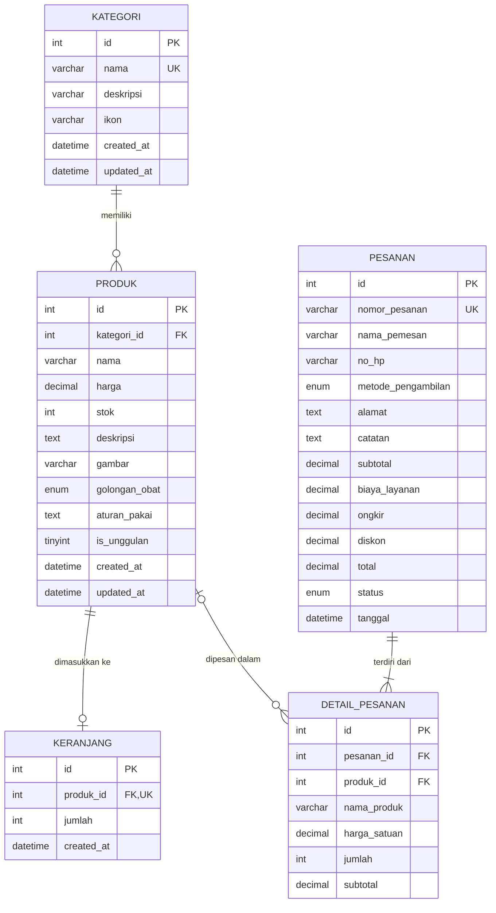

# ERD & Normalisasi — db_apotek

Gambar: [`diagram/erd.png`](diagram/erd.png) (sumber PlantUML: [`diagram/erd.puml`](diagram/erd.puml))

## Relasi & Kardinalitas

| Relasi | Kardinalitas | Aturan FK | Penjelasan |
|---|---|---|---|
| kategori → produk | 1 : N | `ON DELETE RESTRICT` | Satu kategori punya banyak produk. Kategori yang masih punya produk **tidak bisa dihapus** (dicek juga di API dengan pesan jelas). |
| produk → keranjang | 1 : 0..1 | `ON DELETE CASCADE` | `produk_id` UNIQUE di keranjang sehingga satu produk hanya satu baris (jumlah ditambah, tidak dobel). |
| pesanan → detail_pesanan | 1 : N (min 1) | `ON DELETE CASCADE` | Satu pesanan memiliki satu atau lebih item. |
| produk → detail_pesanan | 1 : N | `ON DELETE SET NULL` | Satu produk bisa dipesan berkali-kali. Bila produk dihapus, riwayat tetap utuh karena `nama_produk` & `harga_satuan` disimpan sebagai snapshot. |

## Normalisasi

**Bentuk tidak normal (UNF)** — misalnya satu "nota" berisi: nomor, nama pemesan, HP, lalu daftar
berulang (nama produk, kategori, harga, qty) dalam satu baris.

**1NF** — Menghilangkan grup berulang: setiap item pesanan menjadi baris sendiri dan setiap kolom
bernilai atomik (alamat, no HP, nama produk tidak digabung). Hasilnya tabel pesanan-item dengan
kunci gabungan (nomor_pesanan, nama_produk).

**2NF** — Menghilangkan ketergantungan parsial terhadap sebagian kunci gabungan:
- Atribut yang hanya bergantung pada nomor pesanan (nama pemesan, HP, metode, alamat, total, status,
  tanggal) dipindah ke tabel **pesanan**.
- Atribut yang hanya bergantung pada produk (deskripsi, stok, golongan obat, aturan pakai, gambar)
  dipindah ke tabel **produk**.
- Tersisa **detail_pesanan** (pesanan_id, produk_id, jumlah, harga_satuan, subtotal).

**3NF** — Menghilangkan ketergantungan transitif: di tabel produk, `nama kategori` dan `deskripsi kategori`
bergantung pada kategori (bukan langsung pada id produk), maka dipisah ke tabel **kategori** dan produk
cukup menyimpan `kategori_id` (FK). Nama kategori ditampilkan lewat `JOIN`.

> Catatan desain: `detail_pesanan.nama_produk` & `harga_satuan`, serta kolom `subtotal`/`total`
> di pesanan adalah **denormalisasi terkendali (snapshot historis)** — nilai transaksi harus tetap
> sama walaupun harga/nama produk diedit di kemudian hari. Ini praktik standar sistem transaksi.

Tabel **keranjang** menyimpan produk yang sedang dipilih sebelum checkout (bukan data transaksi),
sehingga cukup `produk_id` + `jumlah`; harga selalu diambil terbaru dari tabel produk via JOIN.
